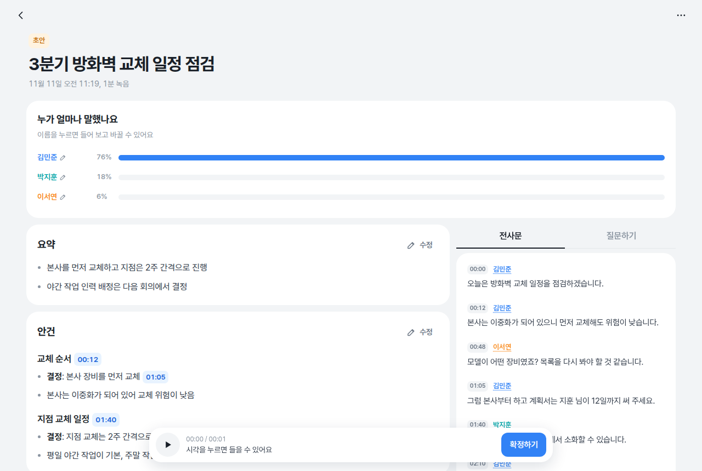
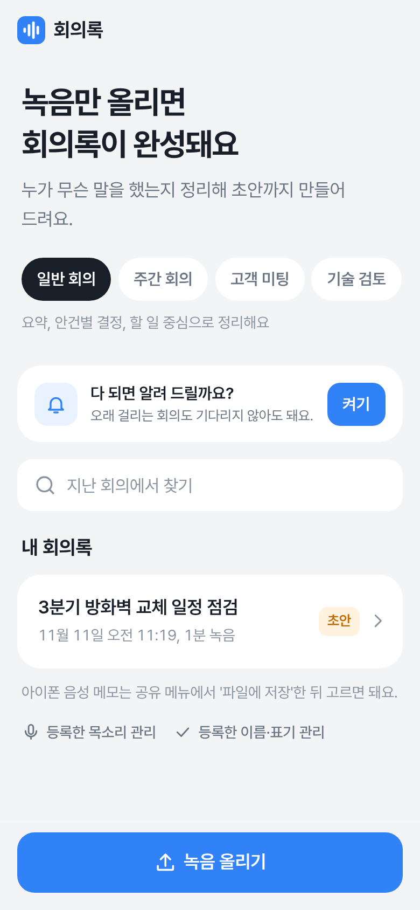
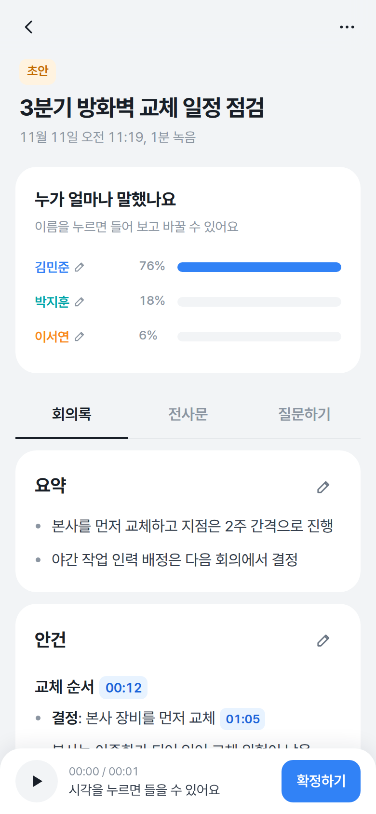
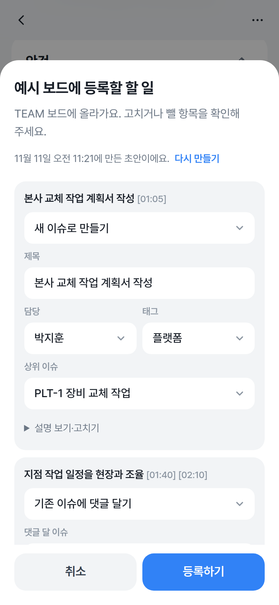

# meeting-notes-agent

회의 녹음을 올리면 화자별 전사문과 회의록 초안을 만드는 셀프 호스팅 웹 앱이다. 전사와 화자 구분은 로컬 CPU에서 WhisperX로 처리하고, 회의록 작성과 질문 답변, 이슈 초안은 Claude API로 만든다.

- 화자 구분 전사. 멀리 앉은 사람의 작은 목소리도 음량을 보정해 받아 적는다.
- 회의 유형별 양식(일반, 주간, 고객 미팅, 기술 검토)에 맞춘 개조식 회의록. 사내 배경 지식과 용어 사전으로 표기를 바로잡는다.
- 회의 내용 질문, 지난 회의 검색, 처리 완료 웹 푸시
- 화자 이름 지정과 목소리 자동 인식(본인이 동의한 사람만)
- 액션 아이템을 이슈 트래커에 등록. 트래커는 어댑터로 붙인다.
- 회사마다 다른 설정은 `company/` 폴더 하나에 둔다.

## 화면



<p>
  
  
  
</p>

예시 회의(`tests/fake_server.py`)로 찍은 화면이다. 아래 줄은 왼쪽부터 첫 화면(회의 양식 고르기, 녹음 올리기), 핸드폰의 회의록 화면, 액션 아이템을 이슈 트래커에 등록하는 창이다.

## 동작 방식


| 단계 | 구현 |
|---|---|
| 전처리 | `highpass` + `dynaudnorm`으로 음량을 고른다. 실패하면 원본을 쓴다. |
| 전사 | faster-whisper `large-v3`(int8, CPU 8스레드), 한국어 정렬 모델 `kresnik/wav2vec2-large-xlsr-korean` |
| 화자 구분 | `pyannote/speaker-diarization-community-1`. 화자별 목소리 특징도 함께 뽑는다. |
| 발언 정리 | 단어별 화자가 바뀌는 지점에서 발언을 나눈다. 화자가 잡히지 않은 "감사합니다" 같은 무음 구간 환각 문구는 버린다. |
| 회의록 | 배경 지식, 용어집, 전사문을 `claude-opus-5-5`에 보내 양식에 맞춘 회의록을 받는다. 길이는 전사문의 20% 이내로 제한한다. |
| 표기 규칙 | 전사문과 모든 모델 출력에 회사 설정의 표기 규칙을 코드로 적용한다. |

작업은 큐에 쌓아 한 번에 한 건씩 처리한다. 처리 중에 서버가 꺼지면 다시 켤 때 그 작업을 큐에 다시 넣고, 전사 결과가 남아 있으면 전사는 건너뛴다.

## 요구 사항

- [uv](https://docs.astral.sh/uv/)(Python 3.12를 설치한다)와 `ffmpeg`
- Hugging Face Read 토큰. [`pyannote/speaker-diarization-community-1`](https://huggingface.co/pyannote/speaker-diarization-community-1) 약관에 동의해야 받을 수 있다.
- Anthropic API 키
- GPU는 필요 없다. i7-1360P 노트북에서 처리 중 메모리를 최대 약 9GB 썼다.

## 빠른 시작

```bash
git clone https://github.com/git-mesome/meeting-notes-agent.git
cd meeting-notes-agent
uv sync
cp -r company.example company

cat > .env <<'EOF'
HF_TOKEN=hf_...
ANTHROPIC_API_KEY=sk-ant-...
EOF

uv run --env-file .env uvicorn meeting_notes.main:create_app --factory
```

http://127.0.0.1:8000 을 연다. 첫 녹음을 처리할 때 전사와 화자 구분 모델을 내려받는다.

## 설정

### 환경 변수

`.env`에 둔다. 이 파일은 커밋하지 않는다.

| 이름 | 필수 | 설명 |
|---|---|---|
| `HF_TOKEN` | 예 | pyannote 화자 구분 모델 다운로드 |
| `ANTHROPIC_API_KEY` | 예 | 회의록, 질문 답변, 이슈 초안 |
| `COMPANY_DIR` | 아니오 | 회사 폴더 위치. 기본값은 프로젝트의 `company/` |
| `PUBLIC_URL` | 로그인할 때 | 이 앱의 바깥 주소. 예: `http://meeting.example:8000`. 있으면 그 호스트를 접속 허용 주소에 더한다. |
| SSO client secret | 로그인할 때 | `[auth]`의 `client_secret_env`가 가리키는 변수 |
| 트래커 토큰 | 어댑터에 따라 | `company.toml`의 `[tracker]`에서 어댑터가 읽을 변수 이름을 정한다. 예: `JIRA_TOKEN` |

### 회사 폴더

회사마다 다른 것은 `company/`에 모은다. 사내 정보가 들어가므로 git에서 제외한다. 다른 회사에서 쓸 때는 이 폴더만 새로 만든다. 없어도 동작하지만 배경 지식과 이슈 등록은 쓰지 않는다.

```
company/
├── company.toml          서버, 표기 규칙, 이슈 트래커 설정
├── knowledge/
│   ├── meeting_context.md  팀, 제품, 고객사 같은 배경 지식
│   └── terms.json          표준 용어 사전
├── glossary.txt          전사할 때 알려 줄 기술 용어
└── <어댑터>.py           이슈 트래커 어댑터
```

`company.toml`:

| 키 | 기본값 | 설명 |
|---|---|---|
| `server.allowed_hosts` | `["127.0.0.1", "localhost", "*.ts.net"]` | 허용할 Host 헤더 |
| `auth.*` | 없음 | 사내 SSO 로그인(아래 "로그인") |
| `spelling` | `"에이아이" = "AI"` | 항상 바꿀 표기. 적은 규칙이 기본값에 더해진다. |
| `tracker.module` | 없음 | 어댑터 파일 이름(`.py` 제외). `[tracker]`가 없으면 이슈 등록을 끈다. |
| `tracker.*` | | 나머지 값은 어댑터의 `create(settings)`에 그대로 넘어간다. |

- `glossary.txt`에는 기술 용어만 한 줄에 하나씩 적는다. 사람 이름이나 회사명을 넣으면 전사 모델이 비슷한 소리를 그 이름으로 바꿔 써서, 실제 발언이 다른 이름으로 기록되거나 사라진다. 고유명사는 `knowledge/`에 둔다.
- `knowledge/`는 회의록과 질문 답변에 쓴다. 전사문의 표기를 바로잡는 데만 쓰고, 회의에 없는 사실을 회의록에 넣지 않는다. 용어 정의는 그 회의에 나온 용어만 보낸다.

## 사용

### 웹 화면

- 녹음을 올릴 때 회의 양식을 고른다. 완성한 뒤에도 다른 양식으로 다시 쓸 수 있다.
- 회의에서 함께 본 자료(PDF, 이미지, txt·md, HTML)를 회의마다 합쳐 20MB까지 붙인다. 회의록을 쓰기 전에 붙이면 회의록을 쓸 때 함께 보내고, 다 쓴 뒤에 붙이거나 지우면 "자료 반영해서 다시 쓰기"로 다시 쓴다. HTML은 제목, 목록, 표, 이미지 설명만 글로 뽑아 보내고, 글이 없는 페이지는 PDF로 저장해 올리라고 안내한다. 붙인 HTML은 내려받기로만 열어 회의록 사이트에서 스크립트가 실행되지 않게 한다. 자료에만 있고 회의에서 말하지 않은 내용은 회의록에 넣지 않는다.
- 회의록은 사람이 확인하고 수정한 뒤 확정한다. 카드마다 있는 "수정"을 누르면 그 자리에서 고치고, 목록은 Enter로 항목을 더하며 표는 "행 추가"로 행을 더한다. 마크다운 전체는 더보기의 "마크다운으로 전체 수정"에서 고친다. 시각 표시를 누르면 그 부분부터 들을 수 있다.
- "확인 필요" 항목은 오른쪽 체크 상자로 직접 확인했는지 표시한다. 체크할 때 확인한 내용(예: "홍길동 부장님이 맞음")을 적으면 회의록에 `- [x] 항목 — 확인: 내용`으로 남는다. 내용을 바꾼 것이 아니므로 확정은 풀리지 않는다.
- "다음 회의록에도 이 이름·표기 쓰기"를 켜면 확인한 내용을 `jobs/memory.json`에 등록하고, 다음 회의록을 쓰고 질문에 답할 때 프롬프트에 참고 메모로 넣어 이름과 표기를 바로잡는 데 쓴다. 모델을 학습시키지는 않는다. 회의마다 다른 확인("미정", "그런 말 없음")이 쌓이지 않도록 기본은 꺼 둔다. 회의에 나오지 않은 사실을 회의록에 넣지는 않고, 음성 인식 단계에는 넣지 않는다. 첫 화면의 "등록한 이름·표기 관리"에서 보고 지운다.
- 화자는 말한 부분을 들어 보고 이름을 정한다. 이름은 회의록, 전사문, 내려받은 파일에 함께 적용된다.
- "다음 회의에서도 이 목소리 알아보기"를 켜면 다음 회의부터 같은 사람에게 이름이 자동으로 붙는다.
- 회의 내용을 질문하면 근거 시각과 함께 답한다. 첫 화면에서 지난 회의의 회의록과 전사문을 검색한다.
- 처리 중인 작업은 중지할 수 있고, 삭제하면 녹음과 결과가 함께 지워진다.
- 더보기의 "공유용 HTML 내려받기"는 팀원에게 보낼 파일을 만든다. 전사문, 근거 시각, 작성자 검토용 "확인 필요"는 빼고 화자 이름을 넣는다. 스크립트 없이 스타일만 담은 파일 하나라 메일에 붙이거나 그대로 열 수 있다.

### 로그인

여러 사람이 쓰는 서버에서는 사내 SSO(OpenID Connect)로 로그인한다. `company.toml`에 `[auth]`를 적고 그 서버의 `.env`에 `PUBLIC_URL`을 두면 켜진다. 둘 중 하나라도 없으면 로그인 없이 동작하므로, 같은 회사 폴더를 쓰는 개인 컴퓨터에서는 지금처럼 쓴다.

```toml
[auth]
issuer = "https://sso.example.com/oidc"   # /.well-known/openid-configuration 이 있는 주소
client_id = "meeting-notes"
client_secret_env = "SSO_CLIENT_SECRET"
role_claim = "role"
allowed_roles = []                         # 비우면 로그인한 사람 모두
admin_subs = []                            # 모든 회의를 고치고 지우는 사람의 sub. 내 sub는 로그인 뒤 /api/me에서 본다.
```

- SSO에 앱을 등록할 때 redirect URI는 `<PUBLIC_URL>/auth/callback`, 로그아웃 뒤 이동 주소는 `<PUBLIC_URL>/`이다.
- authorization code + PKCE(S256)로 로그인하고, ID 토큰의 서명(RS256), 발급자, 대상, 만료, nonce를 확인한다.
- 로그인 상태는 서버 키로 서명한 쿠키(HttpOnly, SameSite=Lax)에 둔다. 키는 `jobs/session-key`에 있다.
- 올린 사람은 회의마다 `meta.json`의 `owner`에 남는다. 로그인한 사람은 `jobs/users.json`에 남아 참석자를 고르는 목록이 된다.

로그인을 켜면 회의마다 권한을 따진다(`jobs/access.py`). 화면은 할 수 없는 일의 버튼을 숨기고, 서버는 같은 규칙으로 403을 낸다.

| 할 일 | 할 수 있는 사람 |
|---|---|
| 보기: 회의록, 녹음, 전사문, 자료 내려받기, 질문, 검색 | 로그인한 사람 모두. "참석자만 보기"를 켠 회의는 올린 사람, 참석자, 관리자만 |
| 고치기: 회의록, 확인 필요, 화자 이름, 확정, 다시 쓰기, 자료, 이슈 등록, 중지와 다시 시작 | 올린 사람, 참석자, 관리자 |
| 관리: 지우기, 참석자와 공개 범위 정하기 | 올린 사람, 관리자 |

- 참석자는 올린 사람이 더보기의 "참석자와 공개 범위"에서 고른다. 이 사이트에 한 번 이상 로그인한 사람만 고를 수 있다.
- "참석자만 보기"를 켠 회의는 다른 사람의 목록과 검색에 나오지 않고, 주소로 열어도 찾을 수 없다고 나온다.
- 로그인을 켜기 전에 올린 회의는 올린 사람이 없어 관리자만 고치고 관리한다. 관리자가 참석자를 정해 주면 그 사람도 고칠 수 있다.

### 핸드폰에서 접속

서버는 `127.0.0.1`에 두고 [Tailscale](https://tailscale.com/)이 같은 tailnet의 기기에만 중계하게 한다.

```bash
tailscale serve --bg --http=80 http://127.0.0.1:8000     # 접속
tailscale serve --bg --https=443 http://127.0.0.1:8000   # 웹 푸시용 HTTPS
```

출력된 `http(s)://<기기 이름>.<tailnet>.ts.net/`을 연다. IP 주소로 접속하면 404가 난다. 아이폰에서 완료 알림을 받으려면 Safari에서 HTTPS 주소를 홈 화면에 추가하고, 추가한 앱에서 알림을 켠다. 음성 메모는 공유 메뉴의 단축어로 올린다(화면 안내 참고). 노트북이 꺼지거나 절전 상태이면 접속되지 않는다.

### 이슈 등록

`[tracker]`를 설정하면 회의록 화면의 액션 아이템 아래에 "<트래커 이름>에 등록" 버튼이 생긴다.

1. 트래커의 팀원, 태그, 열린 이슈와 그 설명 앞부분을 읽고 Claude로 초안을 만든다. 같은 일을 다루는 열린 이슈가 있으면 댓글 초안을 만든다.
2. 초안마다 새 이슈, 기존 이슈에 댓글, 빼기 중에서 고르고 제목, 담당, 태그, 상위 이슈, 설명을 고친다.
3. "등록하기"를 누르고 확인 창에서 한 번 더 승인해야 트래커에 올라간다.

초안은 회의마다 저장하고, 회의록이나 화자 이름이 바뀌었을 때만 새로 만든다. 만드는 중에 창을 닫아도 계속 만들고, 다 되면 알린다. 같은 회의의 초안을 동시에 요청하면 한 번만 만든다. 담당은 회의록의 담당 이름이 팀원 이름과 같을 때만 채운다.

### 명령줄

웹 서버 없이 녹음 하나를 처리한다. 결과는 `outputs/<파일 이름>/`에 저장한다.

```bash
uv run --env-file .env meeting-notes recordings/회의.m4a --template weekly
```

## 서버에 올리기

Docker로 올린다. 회사 폴더, 결과, 모델 캐시는 서버의 폴더를 붙인다. 서버의 `.env` 예시:

```
HF_TOKEN=...
ANTHROPIC_API_KEY=...
PUBLIC_URL=http://meeting.example:8000
CPU_LIMIT=16                        # 다른 서비스와 나눠 쓰도록 묶을 코어 수. 전사 스레드 수도 이 값을 쓴다.
COMPANY_PATH=/srv/meeting-notes/company
DATA_PATH=/srv/meeting-notes/jobs
MODELS_PATH=/srv/meeting-notes/models
BIND_ADDRESS=0.0.0.0               # 기본값 127.0.0.1(서버 자신에서만 접속). 로그인을 켠 뒤에 연다.
```

```bash
docker compose up -d --build
```

결과와 모델 폴더는 컨테이너 사용자(uid 10001)가 쓸 수 있어야 한다. 첫 녹음을 처리할 때 모델 약 4GB를 내려받는다.

### 자동 배포(GitLab)

코드와 회사 폴더는 각자의 GitHub 저장소(공개, 비공개)에 두고, GitLab에는 둘을 합친 저장소 하나를 둔다. GitLab이 받으면 모든 브랜치에서 테스트하고, `main`이면 서버에 배포한다.

```bash
git config meeting-notes.gitlab <GitLab 저장소 SSH 주소>   # 처음 한 번
scripts/push_all.sh                                       # 지금 브랜치를 세 곳에 올린다
```

`scripts/push_all.sh`는 다음 순서로 올린다.

1. 아직 올리지 않은 커밋을 회사 폴더의 `scan-patterns.txt`(사내 정보 정규식 목록)로 검사하고, 걸리는 줄이 없을 때만 공개 저장소에 올린다.
2. 회사 폴더 저장소(`.env`의 `COMPANY_DIR`)의 `main`을 올린다.
3. 코드 트리에 회사 폴더를 `company/`로 얹은 커밋을 만들어 GitLab의 같은 브랜치에 올린다. 합치기는 `.git/gitlab-mirror.git`에서만 하므로 코드 저장소에는 회사 파일이 들어오지 않는다.

GitLab에서 직접 고치거나 머지하지 않는다. 다음에 올릴 때 코드와 회사 폴더 저장소의 내용으로 덮인다.

배포는 서버의 shell 러너가 root로 `scripts/deploy.sh`를 실행한다. 새 이미지를 먼저 만들고, 처리 중인 회의가 끝나기를 기다린 뒤(최대 2시간) 앱과 회사 폴더를 바꿔 끼운다. 새 앱이 1분 안에 응답하지 않으면 앞 버전(`*.prev`)으로 되돌린다. 서버의 `.env`, 결과, 모델 폴더는 건드리지 않는다.

러너는 GitLab 프로젝트의 Settings → CI/CD → Runners에서 태그 `meeting-notes-deploy`로 만든 뒤 서버에 등록한다.

```bash
gitlab-runner register --non-interactive --url <GitLab 주소> --token <러너 토큰> \
  --executor shell --name meeting-notes-deploy --env APP_ROOT=/srv/meeting-notes
```

## 이슈 트래커 어댑터

회사 폴더에 `meeting_notes.issues.Tracker`를 상속한 클래스와, 설정을 받아 그 객체를 돌려주는 `create(settings)` 함수를 둔 파일을 만든다. `create`가 `None`을 돌려주면(토큰이 없을 때 등) 연동하지 않는다. 예시 폴더의 `example_tracker.py`는 이슈를 `issues.json`에 저장하는 연습용 트래커로, 새 어댑터를 만들 때 복사해서 쓴다.

```toml
[tracker]
module = "jira"            # company/jira.py
url = "https://example.atlassian.net"
project = "WEB"
token_env = "JIRA_TOKEN"   # 토큰은 .env에 둔다
```

| 속성 · 메서드 | 설명 |
|---|---|
| `name` | 화면에 쓰는 이름. 예: "Jira에 등록" |
| `destination` | 이슈가 올라가는 곳. 예: "WEB 프로젝트" |
| `categories`, `priorities` | 고를 수 있는 분류와 우선순위. 비우면 그 항목을 쓰지 않는다. 초안은 이 목록 안에서만 고른다. |
| `guide` | 이슈 설명 양식처럼 초안을 쓸 때 더할 규칙 |
| `after_register` | 등록한 뒤 화면에 보여 줄 안내 |
| `issue_url(key)` | 이슈를 열 주소 |
| `people()`, `tags()` | 담당자와 태그 이름 목록 |
| `open_issues()` | 열린 이슈 목록(`key`, `title`, `type`, `status`, `tags`, `assignees`). `type`이 `"epic"`이면 상위 이슈로 고를 수 있다. |
| `issue(key)` | 이슈 하나. `description`으로 같은 일을 다루는지 판단한다. |
| `create(issues)` | 이슈를 만들고 새 키를 같은 순서로 돌려준다. |
| `comment(key, text)` | 댓글을 단다. |

실패는 `meeting_notes.issues.TrackerError`로 알린다. 메시지는 화면에 그대로 보인다.

## 프로젝트 구조

`src/meeting_notes/` 패키지 하나에 계층별로 나눈다. 웹 계층(라우터)은 요청을 받아 서비스를 부르기만 하고, 업무 규칙은 서비스와 그 아래 모듈에 둔다.

```
src/meeting_notes/
├── main.py              앱 조립: 서비스를 만들어 연결하고 라우터·미들웨어를 붙인다
├── settings.py          회사 폴더(company.toml)와 환경 변수 설정
├── errors.py            화면에 보여 줄 오류(404, 409 등). 웹 계층이 HTTP 응답으로 바꾼다
├── llm.py               Claude API 호출(모델, 공통 옵션)
├── questions.py         회의 내용 질문
├── memory.py            사용자가 확인해 준 사실(다음 회의에 참고)
├── cli.py               명령줄 도구(meeting-notes)
├── web/                 HTTP 계층
│   ├── routers/         API: jobs, notes, speakers, issues, push, auth
│   ├── schemas.py       요청 본문 모델
│   ├── deps.py          라우터에 서비스를 넣어 주는 의존성
│   ├── middleware.py    보안 헤더, Host·Origin 검사, 로그인 검사
│   ├── pages.py         index.html, 서비스 워커, 로그인 안내
│   └── static/          화면: js/(화면별 ES 모듈), css/(화면별 스타일)
├── jobs/                store(meta.json), worker(처리 큐), views, search, access(회의별 권한), service
├── pipeline/            audio → transcribe → turns → notes, process가 이어서 실행. documents는 회의 자료
├── speakers/            화자 이름, 목소리 특징, 목소리 등록과 대조
├── issues/              trackers(어댑터 규격), actions, drafting, service
├── auth/                oidc(SSO 로그인), session(쿠키 서명), users(로그인한 적 있는 사람)
└── notifications/       웹 푸시(VAPID)
company.example/         회사 폴더 예시와 연습용 트래커
scripts/                 push_all.sh(GitHub·GitLab에 올리기), deploy.sh(GitLab CI의 서버 배포)
docs/screenshots/        README의 화면(예시 회의로 찍음)
tests/                   pytest, 화면 개발용 가짜 서버
```

스프링에 빗대면 `web/routers`가 `@RestController`, `jobs/service.py`와 `issues/service.py`가 `@Service`, `jobs/store.py`가 Repository, `web/schemas.py`가 DTO, `web/middleware.py`가 Filter, `web/deps.py`의 `Depends`가 생성자 주입, `main.py`가 `@Configuration`이다. 회의별 권한은 `jobs/access.py`의 규칙을 서비스가 메서드마다 확인한다(`@PreAuthorize`에 해당). `web/deps.py`가 요청마다 로그인한 사람을 넣은 서비스 사본을 만든다(request scope).

### 데이터

결과는 `jobs/`에 저장하며 git에서 제외한다.

| 경로 | 내용 |
|---|---|
| `jobs/<id>/meta.json` | 상태, 제목, 양식, 화자 이름, 등록한 이슈, 올린 사람, 참석자, 공개 범위 |
| `jobs/<id>/audio.*` | 올린 녹음 |
| `jobs/<id>/audio.json` | WhisperX 결과 |
| `jobs/<id>/turns.json`, `transcript.txt` | 화자별 발언 |
| `jobs/<id>/notes.md` | 회의록. 직접 고치면 처음 생성본을 `notes.draft.md`에, 다른 양식으로 다시 쓰면 이전 본을 `notes.previous.md`에 남긴다. |
| `jobs/<id>/questions.json` | 질문과 답변 |
| `jobs/<id>/speaker_embeddings.json` | 화자별 목소리 특징(권한 600) |
| `jobs/<id>/issue_drafts.json` | 이슈 초안 |
| `jobs/voices.json` | 등록한 목소리(권한 600) |
| `jobs/memory.json` | 등록한 이름·표기(권한 600) |
| `jobs/users.json` | 로그인한 적이 있는 사람의 sub와 이름(권한 600) |
| `jobs/push-key.pem`, `jobs/push-subscriptions.json` | 웹 푸시 키와 구독 정보 |
| `jobs/session-key` | 로그인 쿠키 서명 키(권한 600) |

## HTTP API

화면이 쓰는 API다. 로그인을 켜면 `/auth/*`와 화면 파일을 뺀 모든 요청에 로그인이 필요하고, 쓰기 요청은 같은 사이트에서 보낸 것만 받는다.

| 메서드 | 경로 | 설명 |
|---|---|---|
| `POST` | `/api/jobs?template=` | 녹음 업로드. multipart 파일이나 요청 본문 그대로(단축어용). 최대 1GB |
| `GET` | `/api/jobs` | 작업 목록과 대기 순서, 예상 시간 |
| `GET` | `/api/jobs/{id}` | 작업 상세. 완료되면 회의록, 발언, 화자, 질문, 등록한 이슈를 함께 준다. |
| `DELETE` | `/api/jobs/{id}` | 삭제 |
| `PUT` | `/api/jobs/{id}/access` | 참석자(`attendees`: sub 목록)와 "참석자만 보기"(`private`) |
| `POST` | `/api/jobs/{id}/cancel`, `/retry` | 중지, 다시 시작 |
| `PUT` | `/api/jobs/{id}/notes` | 회의록 수정 |
| `POST` | `/api/jobs/{id}/documents` | 회의 자료 붙이기(multipart) |
| `GET`, `DELETE` | `/api/jobs/{id}/documents/{name}` | 회의 자료 내려받기, 지우기 |
| `POST` | `/api/jobs/{id}/confirm` | 확정 |
| `PUT` | `/api/jobs/{id}/checks/{index}` | 확인 필요 항목에 확인 표시, 이름·표기 등록 |
| `GET`, `DELETE` | `/api/memory`, `/api/memory/{id}` | 등록한 이름·표기, 지우기 |
| `POST` | `/api/jobs/{id}/regenerate` | 다른 양식으로 다시 쓰기 |
| `PUT` | `/api/jobs/{id}/speakers/{label}` | 화자 이름 지정, 목소리 등록 |
| `POST` | `/api/jobs/{id}/ask` | 질문 |
| `GET` | `/api/jobs/{id}/audio`, `/download` | 녹음 재생, 회의록 내려받기(`.md`) |
| `GET` | `/api/jobs/{id}/share` | 팀원과 나눌 HTML 내려받기 |
| `POST` | `/api/jobs/{id}/issues/drafts?refresh=` | 이슈 초안 |
| `POST` | `/api/jobs/{id}/issues` | 이슈 등록 |
| `GET` | `/api/search?q=` | 회의록, 전사문 검색 |
| `GET` | `/api/templates`, `/api/tracker`, `/api/me` | 양식 목록, 트래커 연동 상태, 로그인한 사용자 |
| `GET` | `/api/users` | 참석자로 고를 수 있는 사람(로그인한 적이 있는 사람) |
| `GET` | `/auth/login?next=`, `/auth/callback`, `/auth/logout` | SSO 로그인과 로그아웃 |
| `GET`, `DELETE` | `/api/voices`, `/api/voices/{id}` | 등록한 목소리 목록, 삭제 |
| `GET`, `POST` | `/api/push/key`, `/subscribe`, `/unsubscribe` | 웹 푸시 |

## 보안과 개인정보

- 로그인을 켜지 않으면 인증이 없다. 그때는 `127.0.0.1`에만 열고 Tailscale로 중계한다. 로그인 없이 `0.0.0.0`으로 열거나 Tailscale Funnel로 공개하면 누구나 회의록을 보고 API 비용을 쓸 수 있다.
- 허용한 Host만 받고, 다른 사이트에서 보낸 쓰기 요청은 본문을 읽기 전에 막는다. CSP와 보안 헤더를 붙인다.
- 녹음과 목소리 특징은 노트북 밖으로 보내지 않는다. 전사문, 회의록, 붙인 회의 자료, 배경 지식, 열린 이슈의 설명 앞부분은 Claude API로 전송된다.
- 목소리 특징은 생체 정보다. 본인이 동의한 사람만 등록하고, "등록한 목소리 관리"에서 지운다.
- Tailscale HTTPS 인증서를 발급하면 기기 이름이 공개 인증서 기록(Certificate Transparency)에 남는다.

## 개발

```bash
uv run pytest
```

테스트는 빈 회사 폴더로 돌아서, 이 컴퓨터의 `company/` 설정에 영향을 받지 않는다. 회사 폴더의 어댑터 테스트는 따로 돌린다(예: `uv run pytest company/`).

화면만 고칠 때는 전사와 API 호출 없이 예시 회의록을 돌려주는 가짜 서버를 쓴다.

```bash
uv run uvicorn tests.fake_server:create --factory --port 8010
```

| 환경 변수 | 기본값 | 설명 |
|---|---|---|
| `FAKE_DATA_DIR` | `jobs-fake` | 가짜 서버의 저장 위치 |
| `FAKE_STAGE_SECONDS` | `15` | 전사 단계에 걸리는 시간(초) |

## 성능

i7-1360P, `large-v3` int8, 8스레드 기준으로 음성 길이의 2.2~2.7배가 걸린다. 36분 녹음은 79~97분 걸렸다. 2분 구간을 잰 결과 화자 구분이 42%, 전사가 35%, 정렬이 16%, 모델 로딩이 7%를 차지했다. 회의록 작성 API 비용은 36분 회의 한 건에 약 0.3달러였다.

## 모델 라이선스

| 모델 | 라이선스 |
|---|---|
| [`Systran/faster-whisper-large-v3`](https://huggingface.co/Systran/faster-whisper-large-v3) | MIT |
| [`pyannote/speaker-diarization-community-1`](https://huggingface.co/pyannote/speaker-diarization-community-1) | CC-BY-4.0(약관 동의 필요) |
| [`kresnik/wav2vec2-large-xlsr-korean`](https://huggingface.co/kresnik/wav2vec2-large-xlsr-korean) | Apache-2.0 |

## 한계

- 등록한 목소리, 이름·표기, 완료 알림은 아직 사람별로 나뉘지 않고 서버 전체에 하나다.
- 로그인을 켜면 아이폰 단축어로 올릴 수 없다. 단축어는 SSO 로그인을 할 수 없기 때문이다.
- CPU로 처리해 녹음 길이보다 두 배 이상 오래 걸리고, 그동안 노트북이 켜져 있어야 한다.
- 마이크 하나로 녹음하므로 짧게 끼어든 말은 다른 화자의 발언에 섞일 수 있다.
- 목소리 자동 인식 기준값(코사인 유사도 0.75)은 회의 하나로 정한 잠정값이다. 다른 장소와 날짜의 회의에서는 알아보지 못하거나 틀릴 수 있다.
